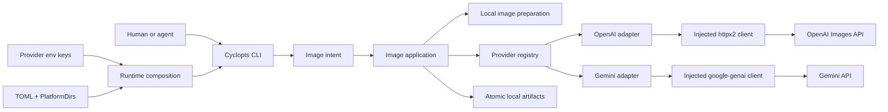

# Architecture

## Overview

Pixgen 0.1 is a local Python 3.14 image CLI. Cyclopts parses a command into a
frozen Pydantic image intent. The application resolves curated model targets,
preflights every target, submits independent jobs under one semaphore, writes
artifacts atomically, and returns one public result. Built-in OpenAI and Gemini
adapters sit behind one internal protocol. Pixgen has no database: the local
artifact files and the returned result are the whole output.

`pixgen.md` holds the full contracts: commands, types, error codes, exit
statuses, catalog evidence, and tests. This document holds the boundaries and
the flows between them.



## Boundaries

### CLI

`src/pixgen/cli/` owns parsing, help, human rendering, JSON selection, and exit
status. It builds generic `image` and `model` sub-apps from injected
dependencies and never imports a provider module.

### Core

`src/pixgen/core/` owns provider-neutral catalog types, image intents,
validated requests, public results, and error codes. It does no filesystem,
network, or configuration work and imports no adapter.

Pydantic checks field shapes only: the `ModelId` pattern, non-empty prompts,
and at least one edit image. Model-dependent rules live elsewhere. Adapters
validate `--param` values against their per-model parameter models.
The application checks decoded media against each target's `MediaRoleSpec`
after loading.

### Images

`src/pixgen/images/` reads each local input once and returns immutable bytes
plus decoded metadata. It knows nothing about media roles, providers, or
output files.

### Application

`src/pixgen/application.py` owns target selection, complete preflight, variant
expansion, concurrency, interrupt handling, result ordering, and public result
assembly. It does not parse commands, render output, or touch HTTP or SDK
types.

### Providers

`src/pixgen/providers/base.py` defines the internal `ImageProvider` protocol.
The OpenAI and Gemini modules own their curated manifests, parameter models,
request translation, response translation, and error mapping. Each receives an
injected vendor client. The protocol is not a public plugin API.

### Artifacts

`src/pixgen/artifacts.py` plans output paths, checks collisions, names files
from the actual media type, and writes through a sibling temporary file and
atomic replacement.

### Runtime

`src/pixgen/runtime.py` is the explicit composition root. It builds settings,
the two vendor clients, the adapters, the registry, and the application, then
the CLI. It creates only the clients the selected command needs, so `model list`
and `model get` need no credentials or network. Clients are injected rather
than held as global singletons.

### Configuration and credentials

Pydantic Settings loads the PlatformDirs user `config.toml`, or an absolute
`PIXGEN_CONFIG` override, with environment values taking precedence. Provider
keys come from `OPENAI_API_KEY` and `GEMINI_API_KEY` as runtime-only secrets;
they never appear in configuration files, results, or logs. There is no
project config or `.env` discovery.

## Concurrency

Cyclopts runs async commands, so leaf commands are `async def` and never call
`asyncio.run()` themselves. The application creates one job per
`(model, variant)`, caps active submissions with one `asyncio.Semaphore`, and
reassembles results in model-selection then variant order.

## Image data flow

```text
parse
→ resolve settings and model targets
→ validate parameters, credentials, and output policy for every target
→ load each distinct local image once; check it against every target
→ submit one request per (model, variant) under the semaphore
→ write each returned image atomically
→ render one human or JSON result
```

## Failure policy

- Invalid targets, media, parameters, credentials, and paths fail the whole
  command before any paid request.
- Paid submissions are never retried; an ambiguous failure may already be
  billed.
- Provider errors are translated inside the adapter; raw bodies, headers, and
  SDK exception text never leave it.
- A failed target does not discard successful targets.
- The first interrupt drains in-flight paid requests; the second cancels.

## Package layout

```text
src/pixgen/
├── __init__.py
├── __main__.py
├── runtime.py
├── application.py
├── artifacts.py
├── images/{models,inspect,mime}.py
├── config/{models,paths}.py
├── core/{models,requests,results,errors}.py
├── providers/{base,registry,openai,gemini}.py
└── cli/{app,image,model,render}.py
```

Do not add repositories, generic services, factories, plugin loaders, a shared
transport, or provider subpackages until a concrete second implementation
needs them.

## Verification boundaries

- Pure unit tests cover core types, parameter parsing, and result invariants.
- Provider tests use `httpx2.MockTransport` for OpenAI and an injected fake
  `google-genai` client for Gemini.
- Application and CLI tests use temporary directories for artifacts and
  configuration.
- Live provider tests are explicitly marked and never run in ordinary CI.
- Pyrefly is the sole type checker.

`pixgen.md` records the current-versus-target divergence in "Current type
review".
