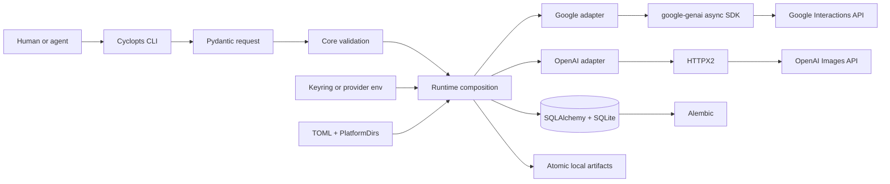

# Architecture

## Overview

Pixgen 0.1 is a local Python 3.14 CLI. Cyclopts parses commands into frozen
Pydantic requests. A small internal registry selects Google or OpenAI from the
canonical model ID. The adapter validates provider-native options, calls the
provider, and returns normalized results. Typed SQLAlchemy rows persist
generation state in SQLite; Alembic owns schema evolution; artifacts are regular
local files.



## Boundaries

### CLI

`src/pixgen/cli/` owns parsing, help, human rendering, JSON selection, and exit
status. It does not construct provider payloads or issue SQL.

### Core

`src/pixgen/core/` owns provider-independent request/result types, media roles,
capabilities, stable errors, and pure validation. It imports neither transport
nor SQLAlchemy.

### Providers

`src/pixgen/providers/base.py` defines an internal async protocol. The built-in
Google and OpenAI modules own exact model manifests, provider-native typed
options, request translation, response translation, and error mapping.

The internal protocol is not a 0.1 public plugin API.

### Runtime

`src/pixgen/runtime.py` is the explicit composition root. It lazily creates only
the settings, credentials, storage, and providers required by the selected
command. Passive commands therefore avoid database and network side effects.
Dependencies are injected; provider clients and database sessions are not
global singletons.

### Configuration and credentials

Pydantic Settings loads only the PlatformDirs user `config.toml`, or an absolute
`PIXGEN_CONFIG` override. Nested `PIXGEN_*` variables override TOML. There is no
project config or `.env` discovery.

Credentials resolve from OS keyring and then `GEMINI_API_KEY` or
`OPENAI_API_KEY`. Secrets never become settings fields or persisted request
data.

### Storage

SQLAlchemy 2 typed declarative rows map generations and artifacts. SQLite uses
WAL, foreign keys, and a finite busy timeout. Alembic migrations ship inside the
package. Storage-using commands upgrade to head before normal sessions; passive
diagnostics only inspect the current revision.

Database transactions are short, synchronous, and never span an async provider
call.

## Core data flow

### Image

```text
parse
→ resolve model
→ validate media/parameters/output
→ resolve credential
→ insert pending UUIDv7 generation
→ submit synchronous provider image request
→ write artifacts atomically
→ persist artifacts and completed status
→ render response
```

`--count` requests a native provider batch only when advertised. `--variants`
creates independent generation records and submits identical requests under an
async semaphore of four.

### Background video

```text
parse and validate
→ resolve Google credential
→ insert pending UUIDv7 generation
→ create background Gemini interaction
→ persist interaction ID and running status
→ return for --no-wait OR poll
→ retrieve output
→ write artifact atomically
→ persist completed status
```

A later process resumes using the local UUIDv7, which resolves the provider and
stored interaction ID. Google background interactions require provider-side
storage; Pixgen documents that retention explicitly.

### Cancellation

Load the generation, reject terminal states, call the provider's remote cancel
operation, and update local state only after the provider confirms cancellation.
Pixgen never marks a remotely running job cancelled only locally.

## Data models

### Core request models

- `ImageCreateRequest`: prompt, canonical model, repeated references,
  normalized image parameters, native parameters, and native count.
- `ImageEditRequest`: prompt, repeated images, optional mask, normalized image
  parameters, native parameters, and native count.
- `VideoCreateRequest`: prompt, canonical model, optional start frame,
  normalized video parameters, and native parameters.

They form a discriminated union on `operation`.

### Persistence rows

`GenerationRow` stores UUIDv7, timestamps, provider/model/operation, normalized
status, provider job ID, sanitized request JSON, and safe error JSON.

`ArtifactRow` stores a local generation relation, absolute local path, MIME
type, byte length, and SHA-256. It does not store remote provider URLs.

## Failure policy

- Invalid capabilities, media, parameters, and paths fail before submission.
- Paid submissions are not retried after an ambiguous transport failure.
- Safe polling reads may use bounded retry with jitter and `Retry-After`.
- Provider errors are translated before leaving the adapter.
- JSON errors are stable Pydantic models; human strings are not machine state.
- A failed variant does not discard successful variants.
- Raw provider responses, credentials, headers, and signed URLs are sanitized
  before logging or persistence.

## Package layout

```text
src/pixgen/
├── __init__.py
├── __main__.py
├── runtime.py
├── cli/{app,image,video,generation,model,system}.py
├── core/{models,requests,results,errors,validation}.py
├── providers/{base,google,openai}.py
├── config/{models,loader,paths}.py
├── storage/{database,models}.py
├── storage/migrations/
├── credentials.py
└── output.py
```

Do not add repositories, DAOs, unit-of-work objects, generic services,
controllers, factories, plugin loaders, or provider subpackages without a
concrete pressure demonstrated by implementation.

## Verification boundaries

- Pure unit tests cover core types and validation.
- Provider contract tests use an injected fake Google SDK client and HTTPX2
  `MockTransport` for OpenAI.
- Integration tests use temporary SQLite databases, real Alembic upgrades,
  subprocess resume, bounded variants, and atomic files.
- Live provider tests are explicitly marked and never run in ordinary CI.
- Pyrefly is the sole type checker.

See [`pixgen.md`](pixgen.md) for the complete contracts, file examples, test
group descriptions, and acceptance criteria.
