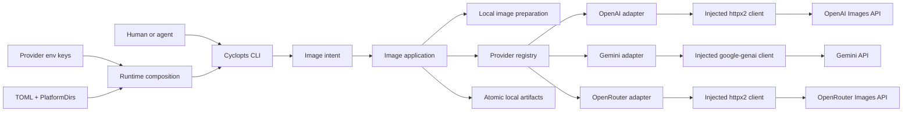

# Architecture

## Overview

Pixgen 0.1 is a local Python 3.14 image CLI. Cyclopts parses a command into a
frozen Pydantic image intent. The application resolves curated model targets,
preflights every target, submits independent jobs under one semaphore, writes
artifacts atomically, and returns one public result. Built-in OpenAI, Gemini, and
OpenRouter adapters sit behind one internal protocol. Pixgen has no database: the local
artifact files and the returned result are the whole output.

`pixgen.md` holds the full contracts: commands, types, error codes, exit
statuses, catalog evidence, and tests. This document holds the boundaries and
the flows between them.



## Boundaries

### CLI

`src/pixgen/cli/` owns parsing, help, human rendering, JSON selection, and exit
status. It builds root `create`, `edit`, and `model` sub-apps from injected
dependencies and never imports a concrete provider module. Shared commands use
canonical `provider/model` IDs and `SharedImageParams`; provider sub-apps own
their native Pydantic options and target one provider-local model. The removed
`image` group and generic `--param` option are not compatibility aliases.

The CLI receives provider factories as explicit dependencies. It validates that
the factory list exactly covers registered providers, has unique names, and
does not declare unsupported operations before it mounts any provider app.

### Core

`src/pixgen/core/` owns provider-neutral catalog types, image intents,
validated requests, public results, and error codes. It does no filesystem,
network, or configuration work and imports no adapter.

Pydantic checks field shapes only: the `ModelId` pattern, non-empty prompts,
and at least one edit image. Model-dependent rules live elsewhere. Adapters
validate typed native parameters against their per-model parameter models. The
application checks decoded media against each target's `MediaRoleSpec` after
loading.

### Images

`src/pixgen/images/` reads each local input once and returns immutable bytes
plus decoded metadata. It knows nothing about media roles, providers, or
output files.

### Application

`src/pixgen/application.py` owns target selection, complete preflight, variant
expansion, concurrency, interrupt handling, result ordering, and public result
assembly. It does not parse commands, render output, or touch HTTP or SDK
types.

### Providers

`src/pixgen/providers/base.py` defines the internal `ImageProvider` protocol.
The OpenAI, Gemini, and OpenRouter modules own their curated manifests,
parameter models, shared-ratio mapping, request translation, response
translation, and error mapping. Each receives an injected vendor client. The
two REST adapters (OpenAI and OpenRouter) share `providers/http.py`, which
holds the lazy authenticated `httpx2` client factory and base64 image decoding.
OpenRouter model IDs keep the upstream slug, so `openrouter/google/gemini-...`
has a nested path after the provider prefix. Providers expose explicit
methods to resolve shared parameters and report supported shared ratios, so the
application and registry do not inspect provider attributes dynamically. The
protocol is not a public plugin API.

### Artifacts

`src/pixgen/artifacts.py` plans output paths, checks collisions, names files
from the actual media type, and writes through a sibling temporary file and
atomic replacement.

### Runtime

`src/pixgen/runtime.py` is the explicit composition root. It builds settings,
the three vendor client factories, adapters, registry, application, and ordered
provider CLI factories. Its frozen `Runtime` value object carries those
dependencies to `main()`, which passes factories to generic CLI assembly. It
creates clients only when a provider request needs them, so `model list` and
`model get` need no credentials or network. Clients are injected rather than
held as global singletons.

### Configuration and credentials

Pydantic Settings loads the PlatformDirs user `config.toml`, or an absolute
`PIXGEN_CONFIG` override, with environment values taking precedence. Provider
keys come from `OPENAI_API_KEY`, `GEMINI_API_KEY`, and `OPENROUTER_API_KEY` as
runtime-only secrets;
they never appear in configuration files, results, or logs. There is no
project config or `.env` discovery.

## Concurrency

Cyclopts runs async commands, so leaf commands are `async def` and never call
`asyncio.run()` themselves. The application creates one job per
`(model, variant)`, caps active submissions with one `asyncio.Semaphore`, and
reassembles results in model-selection then variant order.

## Command composition and extension

Cyclopts composes named sub-apps directly. Pixgen builds one root operation app
for each shared operation, then mounts a fresh provider-owned app for every
factory that supports that operation. A provider command can keep a typed
default handler while the root app retains its shared default handler.

Adding a provider is an internal change: implement the provider protocol and
its CLI factory, register both in `runtime.py`, and add provider and assembly
tests. It does not require a branch in the generic CLI or application code.

Do not add decorator registration, import-time global registries, plugin
loaders, or fluent builders. They would hide the dependency list, make command
order depend on imports, and weaken the explicit test seam. Add another helper
only when duplication survives in typed provider handlers. The third provider
(OpenRouter) justified one such extraction: `providers/http.py` and
`providers/shared.py` hold the helpers OpenAI and OpenRouter had in common.

## Image data flow

```text
parse
→ resolve settings and model targets
→ validate parameters, credentials, and output policy for every target
→ load each distinct local image once; check it against every target
→ submit one request per (model, variant) under the semaphore
→ write each returned image atomically
→ render one human or JSON result
```

## Failure policy

- Invalid targets, media, parameters, credentials, and paths fail the whole
  command before any paid request.
- Paid submissions are never retried; an ambiguous failure may already be
  billed.
- Provider errors are translated inside the adapter; raw bodies, headers, and
  SDK exception text never leave it.
- A failed target does not discard successful targets.
- The first interrupt drains in-flight paid requests; the second cancels.

## Package layout

```text
src/pixgen/
├── __init__.py
├── __main__.py
├── runtime.py
├── application.py
├── artifacts.py
├── images/{models,inspect,mime}.py
├── config/{models,paths,writer}.py
├── core/{definitions,models,parameters,requests,results,errors}.py
├── providers/{base,registry,http,shared}.py
├── providers/{openai,gemini,openrouter}.py
├── providers/{openai_cli,gemini_cli,openrouter_cli}.py
└── cli/{app,contracts,image,invoke,model,options,render}.py
```

Do not add repositories, generic services, plugin loaders, a transport
abstraction beyond the `http.py` helpers, or provider subpackages until a
concrete second implementation needs them.

## Verification boundaries

- Pure unit tests cover core types, shared-ratio resolution, and result invariants.
- Provider tests use `httpx2.MockTransport` for OpenAI and OpenRouter and an
  injected fake `google-genai` client for Gemini.
- Application and CLI tests use temporary directories for artifacts and
  configuration. CLI assembly tests reject missing, unknown, duplicate, and
  operation-incompatible factories before command parsing.
- Live provider tests are explicitly marked and never run in ordinary CI.
- Pyrefly is the sole type checker.

`pixgen.md` records the current-versus-target divergence in "Current type
review".

## References

- [Cyclopts command composition](https://github.com/brianpugh/cyclopts/blob/main/docs/source/commands.rst)
  documents explicit named sub-app registration and default subcommands.
- [PEP 8 public and internal interfaces](https://peps.python.org/pep-0008/#public-and-internal-interfaces)
  explains why documented interfaces need clear boundaries.
