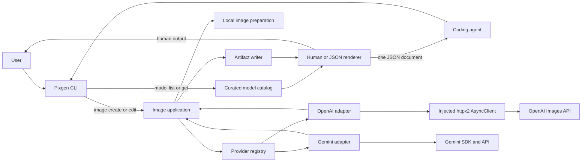
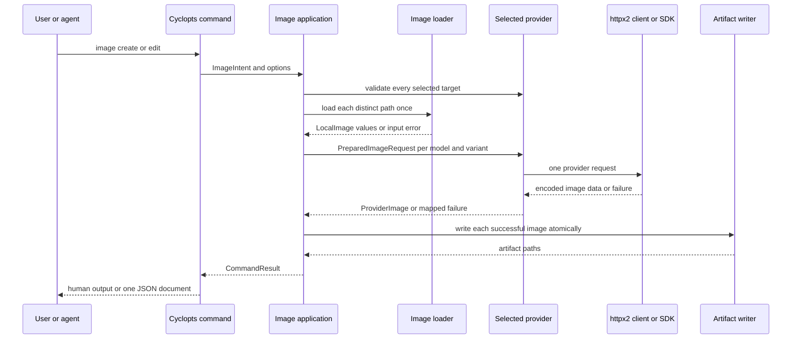

# Pixgen image MVP contract

Verified and revised: 2026-09-24 (provider facts, library behavior, and the
checked-in code were reviewed).

## Product contract

Pixgen is a local, bring-your-own-key CLI for generating and editing images.
It gives people, shell scripts, CI jobs, and coding agents one typed command
shape across OpenAI and Gemini. Pixgen writes explicit local artifacts and
returns structured results for automation.

The MVP succeeds when a caller can select one or more curated models, create
or edit images, submit independent variants in parallel, and receive local
artifact paths or structured errors.

## MVP scope

- Create images from a prompt with ordered reference images.
- Edit one or more ordered input images through a prompt.
- Use built-in OpenAI and Gemini adapters.
- Select repeated models and generate independent variants per model.
- Discover curated models and their parameter schemas offline.
- Configure default model lists and local execution limits.
- Write artifacts atomically and support human output and versioned JSON.

## Command contract

```text
pixgen image create PROMPT
  [--reference PATH ...]
  [--model PROVIDER/MODEL ...]
  [--variants N]
  [--param [PROVIDER/MODEL:]NAME=JSON ...]
  [--output FILE | --output-dir DIRECTORY]
  [--timeout SECONDS]
  [--mkdir] [--force] [--json]

pixgen image edit PROMPT
  --image PATH ...
  [--model PROVIDER/MODEL ...]
  [--variants N]
  [--param [PROVIDER/MODEL:]NAME=JSON ...]
  [--output FILE | --output-dir DIRECTORY]
  [--timeout SECONDS]
  [--mkdir] [--force] [--json]

pixgen model list [--json]
pixgen model get PROVIDER/MODEL [--json]
```

### Command tree

```text
pixgen
├── image                         Image creation and editing
│   ├── create PROMPT              Create from a prompt and optional references
│   └── edit PROMPT                Transform one or more source images
├── model                         Offline curated-model catalogue
│   ├── list                       List models and supported operations
│   └── get PROVIDER/MODEL         Show one model's input and parameter schema
├── --help, -h                     Cyclopts-provided help at every tree level
└── --version                      Print the installed Pixgen version
```

There are deliberately no top-level `config`, `provider`, `history`, `video`,
or `doctor` commands in the MVP. Configuration stays file and environment
based; vendor behavior stays behind the provider protocol.

### Parsing and response contract

| Surface | Contract |
| --- | --- |
| `PROMPT` | Required, non-empty positional text. It remains unmodified by the CLI; adapters translate it for their API. |
| `--reference PATH` | Repeatable and ordered. It is accepted only by `image create`; zero inputs are valid until a selected model says otherwise. |
| `--image PATH` | Repeatable and ordered. It is required by `image edit`. |
| `--model PROVIDER/MODEL` | Repeatable canonical model ID. Explicit values replace configured defaults; omitting it uses the operation-specific configured defaults. |
| `--variants N` | Positive integer. It is expanded after target validation into independent `(model, variant)` jobs, numbered from one. The job count (models × variants) is capped by `max_jobs`. |
| `--param [PROVIDER/MODEL:]NAME=JSON` | Repeatable JSON-valued provider parameter. Unscoped, every selected model must accept the parameter and value. Scoped, it applies to that model only, and the scope must name a selected model. A name appears at most once, scoped or unscoped. Non-finite constants (`NaN`, `Infinity`, `-Infinity`) are rejected. |
| `--output FILE` / `--output-dir DIRECTORY` | Mutually exclusive. A single target may use `--output`; multiple targets require `--output-dir`. An `--output` suffix that conflicts with the target's declared output type fails before submission. |
| `--timeout SECONDS` | Positive whole-run deadline. It overrides the configured `run_timeout_seconds`. |
| `--mkdir` / `--force` | `--mkdir` creates a user-named output parent. `--force` replaces an existing `--output FILE`; generated names never collide, so it has no effect with `--output-dir`. Neither affects the implicit default output directory. |
| `--json` | Selects one machine-readable stdout envelope. It is available on all four leaf commands. |

`model list` and `model get` read only the built-in catalogue. They must not
need network access or provider credentials. `model get` returns the canonical
model ID, supported operations, media rules, documented provider URL, verified
date, and the operation-specific JSON Schema that governs `--param`.

Before submission, commands parse options, resolve models, validate all paths,
parameter values, credentials, and output policy. Invalid input always fails
the whole command with status `2`, before an image request is made. Once a
valid target has been submitted, its outcome is reported independently.

Human mode writes a concise success summary and artifact paths to stdout, and
only errors, warnings, and optional progress to stderr. JSON mode writes
exactly one UTF-8 JSON value followed by one newline to stdout, and nothing
else to stdout. The `image` commands use the `CommandResult` envelope; `model
list` and `model get` use `ModelListResult` and `ModelGetResult`. All three are
serialized with field names from this document and carry `schema_version` and
an optional command-level `error`. The `model` field is the canonical
`provider/model` ID, so a separate provider field is unnecessary. Diagnostics
still go to stderr in JSON mode. Error responses use the same envelope and
exit status, so scripts never have to parse human text. A command that fails
before any target is selected or submitted carries one command-level `error`
and no `results`; once targets are submitted, each outcome is a
`TargetResult`. Warnings that affect a target, such as an `--output` suffix
mismatch, are also recorded in that target's `warnings`, so agents never need
to read stderr.

The primary caller is a coding agent using `--json`. Human output stays
minimal: a short summary and artifact paths.

Examples:

```console
# One target: write the result to an exact file.
pixgen image create "A paper-cut city at dusk" \
  --model openai/gpt-image-2.5-sunburst \
  --output city.png

# Two providers and two variants each: four independent artifacts.
pixgen image create "An editorial photograph of a fern" \
  --model openai/gpt-image-2.5-sunburst \
  --model gemini/gemini-3.1-flash-image \
  --variants 2 --output-dir ./renders --mkdir

# Parameters are JSON and target one selected model in this invocation.
pixgen image edit "Make the sky stormy" --image source.png \
  --model openai/gpt-image-2.5-sunburst \
  --param 'quality="high"' --json

# Scope provider-specific parameters when models from different providers run together.
pixgen image create "A lighthouse in fog" \
  --model openai/gpt-image-2.5-sunburst \
  --model gemini/gemini-3.1-flash-image \
  --param 'openai/gpt-image-2.5-sunburst:quality="high"' \
  --param 'gemini/gemini-3.1-flash-image:aspect_ratio="16:9"' \
  --timeout 110 --json

# Explore the local contract without credentials or a network request.
pixgen model get openai/gpt-image-2.5-sunburst --json
```

`image create` uses `--reference` inputs to guide a new composition. `image
edit` uses `--image` inputs as material to transform. The adapter validates the
selected model's input counts and formats.

`--model` is repeatable. Explicit values replace the configured model list for
that operation. Without explicit values, Pixgen uses the configured list. If
neither exists, the command fails before a provider call.

`--variants` defaults to one and is limited by `max_variants`, defaulting to
ten. Pixgen creates one independent request per selected model and variant
index. Two models with `--variants 3` create six requests. The total job count
is limited by `max_jobs`, defaulting to ten; a larger fan-out fails before
submission with status `2` and `invalid_request`, because every job is a paid
request and no confirmation step exists for agents.

`--param` is repeatable. Pixgen splits each value at the first `=` and parses
the right side with `json.loads(..., parse_constant=...)`, rejecting `NaN`,
`Infinity`, and `-Infinity`; the standard library accepts them by default and
they cannot be re-serialized as JSON. If the left side contains `:`, the text
before it is a model scope; model IDs and parameter names never contain `:`.
An unscoped parameter is global to the invocation, so every selected target
must validate it. A scoped parameter applies only to that model, and a scope
that names an unselected model fails. A name may appear only once, scoped or
unscoped; `quality` and `openai/gpt-image-2.5-sunburst:quality` together fail.
This keeps mixed-provider runs useful while every value is still validated
before submission.

`--output FILE` is valid only when a command yields one result. A command with
several results requires `--output-dir DIRECTORY`. With neither option, Pixgen
writes to configured `output_dir`, or to `./pixgen/` under the current working
directory. Pixgen creates only this implicit directory automatically. Explicit
parents require `--mkdir`, and an existing `--output FILE` requires `--force`.

Generated names in an output directory are
`{timestamp}-{run_id}-{provider}-{model}-v{variant}.{ext}`, for example
`20260924T101500Z-a3f9-openai-gpt-image-2.5-sunburst-v1.png`. The timestamp is
UTC to the second and shared by the run; `run_id` is a short random value also
reported in `CommandResult`. Names are therefore unique per run and never need
`--force`; the writer still refuses to replace an existing file.

Each adapter reports the output media type a validated request declares (for
example, OpenAI `output_format="jpeg"`), or `None` when the provider decides.
Before submission, an `--output` suffix that conflicts with a declared type
fails with status `2`. After generation, Pixgen writes to the exact `--output`
path, reports the actual `media_type`, and warns on stderr and in the target's
`warnings` if it differs from the suffix; a paid result is never discarded for
its name. Generated names in
an output directory always use the actual media type's extension.

## Configuration and credentials

Pydantic Settings reads a user-level PlatformDirs TOML file. `PIXGEN_CONFIG`
selects a different absolute TOML file. Environment values take precedence over
the TOML file. The Settings model loads `OPENAI_API_KEY` and `GEMINI_API_KEY`
into runtime-only `SecretStr` fields through `validation_alias`, because the
`PIXGEN_` environment prefix does not apply to them.

The TOML path is resolved when settings are constructed, not at import:
`settings_customise_sources()` reads `PIXGEN_CONFIG` or the PlatformDirs
default and passes it as `TomlConfigSettingsSource(settings_cls,
toml_file=path)`. A missing default file is empty configuration; a missing
`PIXGEN_CONFIG` file is an `invalid_configuration` error. The CLI and tests
use that one construction path.

```toml
[defaults]
image_create_models = ["openai/gpt-image-2.5-sunburst"]
image_edit_models = ["openai/gpt-image-2.5-sunburst"]

[generation]
output_dir = "/absolute/path/optional"
max_parallel_requests = 4
max_variants = 10
max_jobs = 10
request_timeout_seconds = 300
run_timeout_seconds = 110   # optional; unset means no whole-run deadline
```

`output_dir` defaults to `None`; `artifacts.py` resolves `./pixgen/` against
the working directory at run time. `request_timeout_seconds` bounds one
provider request: the OpenAI client uses it as the `httpx2` read and write
timeout, and the Gemini client receives it in milliseconds, the unit of
`HttpOptions.timeout`. `run_timeout_seconds` defaults to `None` and is
overridden by `--timeout`; each request is bounded by the smaller of the
request timeout and the time left before the run deadline. Pixgen does not
hard-code any agent harness's tool limit. The generated TOML template does not
write credentials.
`runtime.py` reads the two `SecretStr` values only while constructing provider
clients.

## Architecture

The CLI stays provider-neutral. It produces an image intent, selects model
targets, and invokes one application operation. The application validates every
target before submission, schedules jobs, writes artifacts, and creates the
public result. Adapters keep their transport, parameter models, request
translation, and response translation private.



OpenAI uses an injected `httpx2.AsyncClient`; only its adapter owns OpenAI
paths, payload fields, and response/error mapping. Gemini uses the official
`google-genai` SDK. Both choices remain inside their adapter. Neither provider
returns image URLs for these models: OpenAI GPT Image returns base64 data and
Gemini returns inline image bytes, so the MVP has no download path.

### Image command sequence



## Core contracts

Core types express image intent and public results. They do not encode SDK
requests, HTTP payloads, local image bytes, artifact writing, or provider job
states.

```python
# src/pixgen/core/models.py
from __future__ import annotations

from collections.abc import Mapping
from datetime import date
from enum import StrEnum
from typing import Annotated, Self

from pydantic import (
    AnyHttpUrl,
    BaseModel,
    ConfigDict,
    Field,
    JsonValue,
    StringConstraints,
    model_validator,
)


type ModelId = Annotated[
    str,
    StringConstraints(pattern=r"^[a-z0-9][a-z0-9-]*/[a-z0-9][a-z0-9._-]*$"),
]
type JsonObject = dict[str, JsonValue]
type JsonSchema = dict[str, JsonValue]


class ImageOperation(StrEnum):
    IMAGE_CREATE = "image-create"
    IMAGE_EDIT = "image-edit"


class MediaRole(StrEnum):
    REFERENCE = "reference"
    IMAGE = "image"


class MediaRoleSpec(BaseModel):
    model_config = ConfigDict(frozen=True, extra="forbid")

    minimum: int = Field(default=0, ge=0)
    maximum: int = Field(default=1, ge=1)
    formats: frozenset[str] = Field(
        description="Accepted lower-case decoded image formats, for example png."
    )
    max_bytes: int | None = Field(default=None, gt=0)

    @model_validator(mode="after")
    def validate_cardinality(self) -> Self:
        if self.minimum > self.maximum:
            raise ValueError("minimum cannot exceed maximum")
        return self


class ModelSpec(BaseModel):
    model_config = ConfigDict(frozen=True, extra="forbid")

    id: ModelId
    display_name: str = Field(min_length=1)
    operations: frozenset[ImageOperation] = Field(min_length=1)
    media: Mapping[MediaRole, MediaRoleSpec]
    documentation_url: AnyHttpUrl
    verified_at: date
```

`JsonValue` is Pydantic's built-in JSON type; Pixgen does not define its own
recursive alias. `ModelSpec` is frozen but not hashable, because `media` is a
mapping: registries and caches key models by `ModelId`, never by the spec
object. There is deliberately no separate capability enum. A model's
capabilities follow from `operations` plus its `media` rules; for example,
reference-guided creation means `image-create` with a `reference` maximum
above zero.

```python
# src/pixgen/core/requests.py
from __future__ import annotations

from pathlib import Path
from typing import Annotated, Literal

from pydantic import BaseModel, ConfigDict, Field

from pixgen.core.models import ImageOperation, JsonObject, ModelSpec


class ImageIntentBase(BaseModel):
    model_config = ConfigDict(frozen=True, extra="forbid")

    prompt: str = Field(min_length=1)
    params: JsonObject = Field(default_factory=dict)


class ImageCreateIntent(ImageIntentBase):
    operation: Literal[ImageOperation.IMAGE_CREATE] = ImageOperation.IMAGE_CREATE
    references: tuple[Path, ...] = ()


class ImageEditIntent(ImageIntentBase):
    operation: Literal[ImageOperation.IMAGE_EDIT] = ImageOperation.IMAGE_EDIT
    images: tuple[Path, ...] = Field(min_length=1)


type ImageIntent = Annotated[
    ImageCreateIntent | ImageEditIntent,
    Field(discriminator="operation"),
]


class ValidatedImageRequest(BaseModel):
    model_config = ConfigDict(frozen=True, extra="forbid")

    intent: ImageIntent
    model: ModelSpec
    parameters: JsonObject
```

```python
# src/pixgen/core/errors.py
from __future__ import annotations

from enum import StrEnum


class ErrorCode(StrEnum):
    INVALID_REQUEST = "invalid_request"
    INVALID_CONFIGURATION = "invalid_configuration"
    CREDENTIAL_UNAVAILABLE = "credential_unavailable"
    AUTHENTICATION_FAILED = "authentication_failed"
    RATE_LIMITED = "rate_limited"
    MODEL_NOT_FOUND = "model_not_found"
    CONTENT_REJECTED = "content_rejected"
    PROVIDER_UNAVAILABLE = "provider_unavailable"
    TIMEOUT = "timeout"
    INTERRUPTED = "interrupted"
    PROVIDER_FAILURE = "provider_failure"
    ARTIFACT_FAILURE = "artifact_failure"
```

`content_rejected` covers documented provider moderation or safety refusals,
including a Gemini response whose finish reason reports a safety block and
contains no image part. A response with no image and no documented refusal
reason is `provider_failure`. Agents can then tell "change the prompt" apart
from "try again later".

`timeout` covers a single request that exceeded its limit and every job ended
by the whole-run deadline, whether cancelled in flight or never started; the
agent's remedy is the same (raise the budget or reduce the fan-out).
`interrupted` covers jobs skipped or cancelled by SIGINT or SIGTERM, and a
command-level interrupt before any job started.

```python
# src/pixgen/core/results.py
from __future__ import annotations

from pathlib import Path
from typing import Literal, Self

from pydantic import BaseModel, ConfigDict, Field, model_validator

from pixgen.core.errors import ErrorCode
from pixgen.core.models import JsonSchema, ModelId, ModelSpec


class PublicError(BaseModel):
    model_config = ConfigDict(frozen=True, extra="forbid")

    code: ErrorCode
    message: str = Field(min_length=1)


class TargetResult(BaseModel):
    model_config = ConfigDict(frozen=True, extra="forbid")

    model: ModelId
    variant: int = Field(ge=1)
    artifact_path: Path | None = None
    media_type: str | None = None
    error: PublicError | None = None
    warnings: tuple[str, ...] = ()

    @model_validator(mode="after")
    def validate_outcome(self) -> Self:
        if (self.artifact_path is None) == (self.error is None):
            raise ValueError("a target result requires one artifact path or one error")
        if (self.artifact_path is None) != (self.media_type is None):
            raise ValueError("media_type accompanies an artifact path")
        return self


class CommandResult(BaseModel):
    model_config = ConfigDict(frozen=True, extra="forbid")

    schema_version: Literal["1"] = "1"
    run_id: str = Field(min_length=1)
    results: tuple[TargetResult, ...] = ()
    error: PublicError | None = None

    @model_validator(mode="after")
    def validate_outcome(self) -> Self:
        if bool(self.results) == (self.error is not None):
            raise ValueError("a command result requires target results or one command error")
        return self


class ModelListResult(BaseModel):
    model_config = ConfigDict(frozen=True, extra="forbid")

    schema_version: Literal["1"] = "1"
    models: tuple[ModelSpec, ...] = ()
    error: PublicError | None = None


class ModelGetResult(BaseModel):
    model_config = ConfigDict(frozen=True, extra="forbid")

    schema_version: Literal["1"] = "1"
    model: ModelSpec | None = None
    parameter_schemas: dict[str, JsonSchema] = Field(default_factory=dict)
    error: PublicError | None = None

    @model_validator(mode="after")
    def validate_outcome(self) -> Self:
        if (self.model is None) == (self.error is None):
            raise ValueError("a model result requires one model or one error")
        return self
```

`run_id` is generated when an image command starts, so even a failure before
submission carries one; it also appears in generated artifact names.
`warnings` may accompany an artifact or an error. `ModelGetResult.parameter_schemas`
is keyed by operation (`image-create`, `image-edit`).

| Outcome | `CommandResult` | Exit |
| --- | --- | --- |
| Every target wrote an artifact | `results`, all with `artifact_path` | `0` |
| Failure before submission | `error` only | `2` |
| Submitted, no artifact written | `results`, all with `error` | `3` |
| Submitted, mixed outcome | `results`, some of each | `4` |
| Run deadline reached | every job in `results`; ended jobs carry `timeout` | `0`, `3`, or `4` by the normal rules |
| SIGINT | every job in `results` (skipped ones carry `interrupted`), or `error` if none started | `130` |
| SIGTERM | as SIGINT, but in-flight jobs are cancelled | `143` |

### How the request and result models fit together

| Model | Purpose | Why it exists |
| --- | --- | --- |
| `ImageIntent` | The caller's prompt, paths, and provider-neutral parameters. | It is serializable and contains only the user's request. |
| `ValidatedImageRequest` | One `ImageIntent` paired with one curated model after parameter validation. | It prevents adapters from redoing model selection and parameter checks. |
| `PreparedImageRequest` | A validated request plus loaded `LocalImage` values. | It gives adapters verified original bytes without reopening files. |
| `ProviderImage` | One internal provider result as bytes and MIME type. | It keeps HTTP and SDK response types out of the application and artifact writer. |
| `CommandResult` | The public result for human or `--json` output. | It never includes binary data, secrets, or vendor response bodies. |

`PreparedImageRequest` and `ProviderImage` are internal provider types defined
in the next section. The other rows are core contracts.

Create and edit use different models because their input rules differ.
`MediaRole` stays in the catalog because each model can accept different counts
and formats for references and editable images.

## Provider protocol

The provider protocol is a stable internal contract. It has no SDK or HTTP
types and is not an external plugin API.

```python
# src/pixgen/providers/base.py
from __future__ import annotations

from dataclasses import dataclass
from typing import Protocol, runtime_checkable

from pixgen.core.models import ImageOperation, JsonSchema, MediaRole, ModelId, ModelSpec
from pixgen.core.requests import ImageIntent, ValidatedImageRequest
from pixgen.images.models import LocalImage


@dataclass(frozen=True, slots=True)
class PreparedMedia:
    role: MediaRole
    image: LocalImage


@dataclass(frozen=True, slots=True)
class PreparedImageRequest:
    request: ValidatedImageRequest
    media: tuple[PreparedMedia, ...]


@dataclass(frozen=True, slots=True)
class ProviderImage:
    data: bytes
    media_type: str


@runtime_checkable
class ImageProvider(Protocol):
    name: str

    def models(self) -> tuple[ModelSpec, ...]: ...
    def parameter_schema(
        self,
        model: ModelId,
        operation: ImageOperation,
    ) -> JsonSchema: ...
    def validate(
        self,
        *,
        intent: ImageIntent,
        model: ModelSpec,
    ) -> ValidatedImageRequest: ...
    def declared_media_type(self, request: ValidatedImageRequest) -> str | None: ...
    async def generate(self, request: PreparedImageRequest) -> ProviderImage: ...
```

`ProviderRegistry` maps each canonical model ID to an adapter and exposes the
combined curated catalog. Each adapter owns Pydantic parameter models per model
and operation. They validate `--param` values and generate the JSON Schema for
`pixgen model get`.

`PreparedImageRequest` combines a validated core request with ordered,
read-once `LocalImage` values. It keeps filesystem I/O out of adapters while
preserving the caller's explicit reference and image roles. `ProviderImage` is
an internal binary provider result; it is not part of the public JSON schema.
`declared_media_type()` returns the output type a validated request fixes in
advance, such as `image/jpeg` for OpenAI `output_format="jpeg"`, or `None`
when the provider chooses; the application uses it for the `--output` suffix
check.

The OpenAI adapter receives an injected `httpx2.AsyncClient`. `runtime.py`
builds it with the OpenAI base URL, an `Authorization` header from the
`SecretStr` key, and an explicit `httpx2.Timeout`. It does not add retry
transports. The adapter builds the JSON or multipart request itself. The
generations endpoint accepts no input images, so `image create` without
references uses `POST /v1/images/generations`, while `image create` with
references and every `image edit` use multipart `POST /v1/images/edits`. The
create/edit split is a product distinction; for OpenAI only the presence of
input images selects the endpoint. The Gemini
adapter receives an injected `google.genai.Client` built with
`HttpOptions(timeout=<ms>, retry_options=HttpRetryOptions(attempts=1))`, so the
no-retry rule holds whatever the SDK defaults are. It requests
`response_modalities=["IMAGE"]`. Each adapter maps its response to
`ProviderImage`. The application maps adapter failures to `PublicError` before
building `CommandResult`.

Each adapter maps its client's failures itself. The OpenAI adapter maps
`httpx2` timeout and connection exceptions, status codes, and documented error
fields to Pixgen codes such as `authentication_failed`, `model_not_found`,
`rate_limited`, `content_rejected`, `timeout`, and `provider_unavailable`. The
Gemini adapter maps SDK errors and finish reasons the same way. Raw response
bodies, headers, and SDK exception text never reach public output.

A shared HTTP transport package is deliberately absent. `httpx2` already
provides timeouts, headers, and `MockTransport`, and only one adapter uses it.
Extract a thin transport only when a second REST adapter, such as an
OpenAI-compatible provider, needs the same boundary.

## Image preparation

`images/` is an internal package for built-in adapters, not a plugin API. It
prepares local sources. Provider adapters own endpoint URLs, JSON and
multipart field names, documented vendor error types, and response schemas.

```python
# src/pixgen/images/models.py
from __future__ import annotations

from dataclasses import dataclass
from pathlib import Path


@dataclass(frozen=True, slots=True)
class LocalImage:
    source_path: Path
    filename: str
    content: bytes
    media_type: str
    decoded_format: str
    width: int
    height: int

    @property
    def byte_size(self) -> int:
        return len(self.content)


class ImageInputError(ValueError):
    """A safe, path-specific preflight failure."""
```

The image loader accepts local regular files only. It applies an input-size
guard before reading and reads each file once. It then works on those bytes
with Pillow:

1. It opens them with `Image.open(..., formats=...)`, restricted to the formats
   Pixgen maps to MIME types, and calls `verify()`.
2. `verify()` does not decode pixel data and leaves the image unusable, so the
   loader reopens the same bytes to read format and dimensions.
3. It rejects any image whose `width * height` exceeds an explicit pixel cap.
   Some format plugins, WebP included, skip Pillow's built-in bomb check when
   opening.
4. It treats `DecompressionBombWarning` as an error and catches
   `DecompressionBombError`. The error subclasses `Exception`, not `OSError`,
   so catching only `OSError` misses it.

Every failure becomes an `ImageInputError` with a safe, path-specific message
that never includes Pillow's exception text. The loader preserves the original
bytes and derives a lower-case MIME type and decoded format. It never resizes,
converts, recompresses, or mutates EXIF metadata. The application loads each
distinct path once, then validates the metadata against every selected
`MediaRoleSpec` before submission.

`artifacts.py` chooses local output names from the target and the actual
media type. It never uses a provider-supplied filename.

## Curated catalog

These facts were checked against the vendor guides on 2026-09-24. Each
manifest records its own `verified_at` date. A model appearing in the catalog
does not guarantee that a particular account can use it.

| Canonical ID | Evidence that shapes the manifest |
| --- | --- |
| `openai/gpt-image-2.5-sunburst`, `openai/gpt-image-2.5-flare` | Image API returns base64 only. The edits endpoint takes up to 16 input images, each a PNG, JPEG, or WebP file under 50 MB; no total request limit is stated. Manifest: `reference` 0–16, `image` 1–16, `max_bytes` 50 MB per file, citing the API reference (the 16-image cap came from a fetched summary; confirm it on the reference page before merging). Parameters: `size` (presets, custom multiples of 16 up to 3840 px per edge, `auto`), `quality` (`low`–`max`, `auto`), `background`, `output_format`, `output_compression`, `moderation`. `n` and `mask` are not exposed: variants are independent requests, and masks are deferred. |
| `gemini/gemini-3.1-flash-image` | Up to 10 object references; aspect ratios 1:1–21:9; sizes 0.5K–4K. |
| `gemini/gemini-3.1-flash-lite-image` | Up to 14 object references; 1K only. |
| `gemini/gemini-3-pro-image` | Up to 6 object references. |

Gemini states separate caps for object and character references. Pixgen cannot
tell which kind a local file is, so `MediaRoleSpec.maximum` uses the documented
object cap and cites it. Gemini outputs carry a SynthID watermark. That is a
property of the provider's output, not something Pixgen controls.

Sources: [OpenAI image generation](https://developers.openai.com/api/docs/guides/image-generation),
[Gemini image generation](https://ai.google.dev/gemini-api/docs/image-generation).

## CLI composition

Cyclopts command modules export generic sub-apps. The root registers them while
remaining unaware of provider details.

```python
# src/pixgen/cli/app.py
from cyclopts import App

from pixgen.application import ImageApplication
from pixgen.cli.image import build_image_app
from pixgen.cli.model import build_model_app


def build_app(application: ImageApplication) -> App:
    app = App(name="pixgen", help="Generate and edit images.")
    app.command(build_image_app(application))
    app.command(build_model_app(application))
    return app
```

`runtime.py` constructs settings, adapters, the registry, and the application
before it calls `build_app()`. The root app registers no default command, so
bare `pixgen` prints help instead of silently exiting `0`. Cyclopts derives
`--version` from the installed package metadata.

## Package boundaries

```text
src/pixgen/
  __init__.py          version metadata only; importing pixgen has no CLI side effect
  __main__.py          delegates to cli.app.main for python -m pixgen
  runtime.py           composition root for settings, clients, adapters, and application
  application.py       one image-use-case coordinator
  artifacts.py         output planning, names, collision checks, atomic writes
  images/
    __init__.py        package marker
    models.py          immutable LocalImage and safe input errors
    inspect.py         one-read Pillow verification and decoded metadata
    mime.py            decoded-format to MIME mapping
  config/
    __init__.py        package marker
    models.py          Pydantic Settings and nested defaults/generation models
    paths.py           PlatformDirs and PIXGEN_CONFIG resolution
  core/
    __init__.py        package marker
    models.py          catalog types, model IDs, image operations, input rules
    requests.py        image intent and validated provider request types
    results.py         command result, target result, and public error models
    errors.py          public error-code enum and private domain exceptions
  providers/
    __init__.py        package marker
    base.py            ImageProvider, prepared input, and binary result contracts
    registry.py        immutable model-ID to provider lookup and catalog aggregation
    openai.py          OpenAI manifest, REST translation, and response/error mapping
    gemini.py          Gemini manifest, parameter models, SDK translation, response mapping
  cli/
    __init__.py        package marker
    app.py             root Cyclopts app builder and console entry point
    image.py           image sub-app builder and create/edit argument parsing
    model.py           model sub-app builder and list/get rendering inputs
    render.py          human tables, JSON serialisation, stderr diagnostics, exit mapping
```

| Package or module | Owns | May depend on | Must not know about |
| --- | --- | --- | --- |
| `runtime.py` | Settings, client lifetime, adapter construction, and application wiring. | Every production package. | Command parsing and vendor payload details. |
| `application.py` | Target selection, complete preflight, variant expansion, concurrency, result ordering, and public result assembly. | `core/`, `providers/`, `images/`, `artifacts.py`. | Cyclopts, HTTP clients, SDK types, or vendor request shapes. |
| `artifacts.py` | Output planning, collision checks, generated names, and atomic local writes. | Standard library and provider result bytes. | Provider identity, HTTP, or SDKs. |
| `core/` | Curated model data, caller intent, validation results, public errors, and public JSON models. | Pydantic and the standard library. | Filesystem I/O, configuration, HTTP, SDKs, and providers. |
| `images/` | One-read local input inspection, decoded metadata, and original bytes. | Pillow and the standard library. | Media roles, provider fields, multipart encoding, and output files. |
| `config/` | PlatformDirs paths, TOML and environment loading, and runtime-only secrets. | Pydantic Settings, PlatformDirs, `core/`. | Provider resolution, directories for artifacts, and CLI parsing. |
| `providers/` | Curated vendor manifests, parameter validation, request translation, response translation, and provider error mapping. | `core/`, `images/`, and one injected vendor client (`httpx2` or `google-genai`). | Cyclopts, artifact writes, or another concrete provider. |
| `cli/` | Cyclopts commands, help, human rendering, JSON rendering, stderr diagnostics, and exit mapping. | `application.py`, `config/`, `core/`. | Provider modules and vendor dependencies. |

The allowed dependency direction is:

```text
cli -> application -> providers -> core
                 -> images
                 -> artifacts -> core
providers -> images
runtime -> config, providers, application, cli
config -> core
```

`runtime.py` may depend on every production package because it wires them.
Every other direction is one-way. This prevents a provider change from leaking
into CLI parsing, artifact output, or the public JSON contract.

## Execution and output

For each command, the application:

1. Parses input and resolves settings.
2. Selects explicit or configured model targets.
3. Validates parameters and output policy, then loads every distinct local
   image once and validates decoded metadata against every target before sending
   a request.
4. Builds one `PreparedImageRequest` per model and variant index.
5. Runs jobs through an `asyncio` semaphore limited by
   `max_parallel_requests`, defaulting to four.
6. Atomically writes each successful image.
7. Returns results in model-selection order and then variant-index order.

Provider submissions do not retry. A transport failure can follow a billable
request. Pixgen lets already-submitted parallel jobs finish, writes successful
artifacts, and reports complete partial results.

Every requested `(model, variant)` job appears in `results` with an outcome;
none is omitted.

The first interrupt (`Ctrl-C`, `SIGINT`) stops starting queued jobs, lets
in-flight paid requests finish, writes their artifacts, and reports every job.
Jobs that never started carry `interrupted`. If no job had started, the
envelope carries a command-level `interrupted` error. A second interrupt
cancels in-flight jobs immediately, removes temporary files, keeps artifacts
already written, and makes no JSON-envelope guarantee. Either way the exit
status is `130`. Cancelling a request locally does not cancel provider
billing, which is why the first interrupt from a person drains instead.

Automated callers cannot wait for a drain. Agent harnesses and CI runners
enforce their own tool timeouts, and usually send SIGTERM followed shortly by
SIGKILL, so a process that waits emits nothing. Two paths therefore finish at
once instead of draining:

- The run deadline (`--timeout` or `run_timeout_seconds`) stops starting
  queued jobs, cancels in-flight jobs, writes artifacts that already finished,
  and emits the envelope. Ended jobs carry `timeout`, and the exit status
  follows the normal `0`/`3`/`4` rules, because the caller asked for the
  deadline.
- SIGTERM behaves the same way, but ended jobs carry `interrupted` and the
  exit status is `143`.

Cancelled paid requests are lost, but the caller always receives a structured
result. Skipping queued jobs that cannot finish before the deadline needs
duration data and is deferred.

Artifact writes use a sibling temporary file followed by atomic replacement.
Successful human output goes to stdout. Human errors, warnings, and
diagnostics go to stderr. Progress goes to stderr only when stderr is a TTY,
because agent harnesses capture stderr into the model's context. Under `--json`, stdout contains one versioned JSON envelope for
success and failure. Each target result contains the canonical model ID (which
names the provider), the variant index, the artifact path and media type when
present, and a structured public error otherwise. It excludes credentials,
authorization headers, raw provider bodies, and SDK exception text.

Exit statuses:

- `0` when every target succeeds.
- `2` for CLI, configuration, local-input, output-policy, or parameter errors
  before submission.
- `3` when valid submissions produce no usable artifact.
- `4` when at least one target succeeds and at least one target fails.
- `130` after SIGINT.
- `143` after SIGTERM.

## Verification

Normal tests use no credentials and never submit paid work.

- Core tests cover request types, target expansion, parameter parsing
  (including rejected `NaN`/`Infinity`), global and scoped parameter
  validation (unselected scopes, duplicate names across scopes), the
  `max_jobs` cap, ordering, the `CommandResult` outcome table, the model
  envelopes, and public error serialisation.
- Configuration tests cover PlatformDirs, absolute `PIXGEN_CONFIG` read at
  construction time, missing-file behavior, environment precedence, API-key
  aliases, and settings bounds.
- OpenAI adapter tests use `httpx2.MockTransport` for translation, endpoint
  selection (generations without input images, edits with them), one attempt
  per request, status and error-field mapping (including `content_rejected`),
  timeout mapping, and absence of raw bodies in public errors.
- Gemini adapter tests inject a fake SDK client for the same behavior, plus
  text-only and safety-blocked responses.
- Image utility tests cover one-read behavior, original-byte preservation,
  decoded MIME mapping, corrupt input, oversize input, `DecompressionBombError`,
  the escalated bomb warning, and the explicit pixel cap on a WebP input.
- Application tests cover semaphore bounds, full preflight, one load per
  distinct input path, the `--output` suffix check, atomic artifacts, partial
  results, generated names with `run_id`, collision handling, the run
  deadline, SIGINT drain, SIGTERM cancellation, and interrupt cleanup.
- CLI tests cover generic sub-app registration, defaults, repeated models,
  references versus images, human output, JSON, stderr separation, TTY-only
  progress, and exits.

## Current type review

The checked-in source is an earlier prototype. Manual implementation should
align it with this document instead of extending both shapes in parallel.

Baseline on 2026-09-24: `ruff check` and `pyrefly check` pass, and `pytest`
collects no tests. The staged change that removes Pillow `AfterValidator`s
from `MediaReference` moves in the right direction: file checks belong in
`images/`, not in field validators.

| Current module | Finding | Required target |
| --- | --- | --- |
| `core/models.py` | `Capability` duplicates `Operation` plus media rules. `MediaKind`, `GenerationStatus`, `supports_cancel`, `mask`/`start-frame` roles, and the hand-rolled `*ParameterSpec` mini-schema are video, lifecycle, or JSON Schema duplicates. `MediaRoleSpec` lacks `extra="forbid"` and the minimum/maximum check. `ModelId` accepts any text after `/`. | The core types above: `ImageOperation`, `MediaRole` (reference, image), `MediaRoleSpec`, and `ModelSpec` with `operations`; parameter schemas come from adapter Pydantic models. |
| `core/requests.py` | Normalized `aspect_ratio`, `resolution`, and `count`, one `model` per request, `mask`, and `VideoCreateRequest` contradict "params only; variants in the application". The staged change made `ImageEditRequest.images` default to `()`. The custom recursive `JsonValue` duplicates Pydantic's. | The `ImageIntent` union with `images` requiring at least one path; `pydantic.JsonValue`. |
| `core/validation.py` | `file_integrity` catches `(OSError, SyntaxError)` only, so `DecompressionBombError` (an `Exception` subclass) escapes. It embeds raw Pillow text in messages. `FieldError` has no consumer in the target design. | Delete. Move inspection to `images/inspect.py` using the rules in Image preparation. |
| `core/errors.py` | `GENERATION_FAILED`, `GENERATION_CANCELLED`, `ARTIFACT_ERROR`, and `INTERNAL_ERROR` differ from the contract. | The `ErrorCode` above, including `content_rejected` and `interrupted`. |
| `providers/base.py` | Job lifecycle (`get`, `cancel`, `provider_job_id`, `ProviderUsage`), `fetch_url`, and `retryable` are outside the MVP. `Provider` is not `@runtime_checkable`. | `ImageProvider`, `PreparedImageRequest`, `PreparedMedia`, and binary `ProviderImage`; provider clients stay private injected dependencies. |
| `providers/openai.py` | Not yet written. | Translate prepared input to OpenAI JSON or multipart fields using the injected `httpx2.AsyncClient`; map responses and documented failures; never open image paths or construct a client. |
| `images/` | Empty package. | Immutable `LocalImage` and one-read Pillow inspection per Image preparation. |
| `transport/` | Empty untracked package. | Remove; see Provider protocol. |
| `config/models.py` | `toml_file=resolve_config_path()` is fixed at import, so `PIXGEN_CONFIG` cannot apply. Defaults use `google/` IDs and a video model. `output_dir` uses `default_factory=Path.cwd`, which captures the working directory at load time. `wait_timeout` and `wait_interval` are video polling leftovers. API keys are not modelled. | Operation-specific model tuples with `gemini/` IDs, `output_dir: Path \| None = None`, concurrency, variant, `max_jobs`, request and optional run timeout bounds, and aliased `SecretStr` keys. Resolve the TOML path in `settings_customise_sources()`. |
| `config/loader.py` | With a path, `Settings.model_validate(tomllib.load(...))` skips the source chain, so environment precedence is lost. | Delete; `Settings()` is the one construction path. |
| `config/paths.py` | `cache_path()` and `data_path()` have no consumer in an MVP without persistence. | Keep only config-path resolution. |
| `cli/app.py` and `cli/image.py` | Module-level apps; root `@app.default` no-op makes bare `pixgen` exit `0` silently; `info` and `doctor` are out of scope. | `build_app(application)` with generic `image` and `model` sub-apps and no root default. |
| `__init__.py` | Imports the CLI at package import. Ruff's `extend-exclude` skips `__init__.py`, so it is never linted. | Version metadata only; console entry point `pixgen.cli.app:main`. |
| `pyproject.toml` | `pydantic-settings[yaml]` extra is unused (TOML uses the standard library). | Plain `pydantic-settings`; add `google-genai`. |

Apply the repository conventions to every Python module changed during manual
implementation: module docstrings, future annotations, sorted `__all__`,
runtime-checkable protocols, documented Pydantic fields, and fully typed public
functions. Ruff does not currently select the `D` (pydocstyle) rules and
excludes `__init__.py`, so docstrings are unenforced. Selecting `D` and removing
the `__init__.py` exclusion would make the convention checkable.

## Implementation references

The rows below are the implementation reading list. Versions are those pinned
in the current lockfile unless the dependency is intentionally not present.
Use the library feature named here instead of adding an abstraction that
duplicates it.

| Library | Version | Use in Pixgen | Primary documentation |
| --- | --- | --- | --- |
| Cyclopts | 4.25.2 | Build named `image` and `model` `App` objects and register them on the root. Let Cyclopts provide `--help`, `-h`, and `--version`; write command docstrings because they become help text. Keep commands eagerly registered for this small MVP. | [Help and named sub-apps](https://cyclopts.readthedocs.io/en/latest/help.html) · [lazy loading, deferred](https://cyclopts.readthedocs.io/en/latest/lazy_loading.html) |
| Pydantic | 2.13.5 | Use frozen, `extra="forbid"` models for public contracts; discriminated unions for create versus edit; the built-in `pydantic.JsonValue` for parameter values; and `model_json_schema()` for model parameter discovery. | [Types and named recursive types](https://pydantic.dev/docs/validation/latest/concepts/types/) · [JSON Schema](https://pydantic.dev/docs/validation/latest/concepts/json_schema/) |
| Pydantic Settings | 2.15.0 | Use `BaseSettings`, `SettingsConfigDict`, and `TomlConfigSettingsSource(settings_cls, toml_file=path)` built inside `settings_customise_sources()` to combine PlatformDirs config, the absolute `PIXGEN_CONFIG` override, and environment values. Hold API keys in `SecretStr`; never include them in serialized results. | [Settings management](https://pydantic.dev/docs/validation/latest/concepts/pydantic_settings/) |
| httpx2 | 2.12.0 | Let `runtime.py` own one `AsyncClient` with base URL, auth header, and explicit `httpx2.Timeout`, injected into the OpenAI adapter. Add no retrying transport; test requests and error mapping with `MockTransport`. | [httpx2 repository and API](https://github.com/pydantic/httpx2) |
| google-genai | add for MVP | Inject the official SDK client into the Gemini adapter only, built with `HttpOptions(timeout=<milliseconds>, retry_options=HttpRetryOptions(attempts=1))`. Use `client.aio.models.generate_content` with `response_modalities=["IMAGE"]` and `ImageConfig`. Follow its image-generation examples for create and image-to-image translation; expose neither SDK models nor client types outside `providers/gemini.py`. | [Gemini image generation](https://ai.google.dev/gemini-api/docs/image-generation) |
| PlatformDirs | 4.11.8 | Resolve the platform-appropriate user config directory. Keep path selection in `config/paths.py`; do not use it to create output directories. | [PlatformDirs documentation](https://platformdirs.readthedocs.io/en/latest/) |
| Rich | 15.0.0 | Render only human-facing tables and messages in `cli/render.py`. Instantiate consoles with explicit `stdout` or `stderr`; JSON is standard-library `json` on stdout, never Rich. | [Console API](https://rich.readthedocs.io/en/latest/console.html) |
| Pillow | 12.3.0 | In `images/`, inspect local input after an existence and size check; open with `formats=`, `verify()`, then reopen for format and dimensions; enforce an explicit pixel cap and treat bomb warnings and errors as input errors. Preserve original bytes; do not transform or re-encode input. | [Image API](https://pillow.readthedocs.io/en/stable/reference/Image.html) |
| `asyncio` | Python 3.14 stdlib | Create deterministic jobs, cap active submissions with one semaphore, and collect every completed task so partial outcomes are preserved. Do not put `asyncio.run()` inside leaf commands: Cyclopts supports async commands. | [Coroutines and tasks](https://docs.python.org/3/library/asyncio-task.html) |

`keyring` is installed for the agreed future credential store, but MVP credential
resolution is environment plus settings only. `sqlmodel` is installed but is
not used: the MVP has no persistence. `stamina` is installed but is not used:
provider submissions intentionally do not retry because an ambiguous transport
failure may already be billable. Treat all three as future dependencies rather
than wiring them preemptively.

For provider request details, use the primary vendor guides, not copied request
models: [OpenAI image generation](https://developers.openai.com/api/docs/guides/image-generation)
for the direct HTTP adapter and [Gemini image generation](https://ai.google.dev/gemini-api/docs/image-generation)
for the SDK adapter. Keep the curated manifests in Pixgen even when vendor
documentation changes; `verified_at` makes that review explicit.

## Nice to have

- Native provider image batches and masks.
- OS-keyring credentials and managed provider profiles.
- Generation history, resumable jobs, cancellation, and video generation.
- Optional provider plugins, provider-specific CLI extensions, and lazy command
  loading.
- Live model discovery and an agent skill.
- Bounded HTTPS downloads for providers that return image URLs; no MVP model
  does.
- A thin shared REST transport once a second REST adapter, such as an
  OpenAI-compatible provider, exists.
