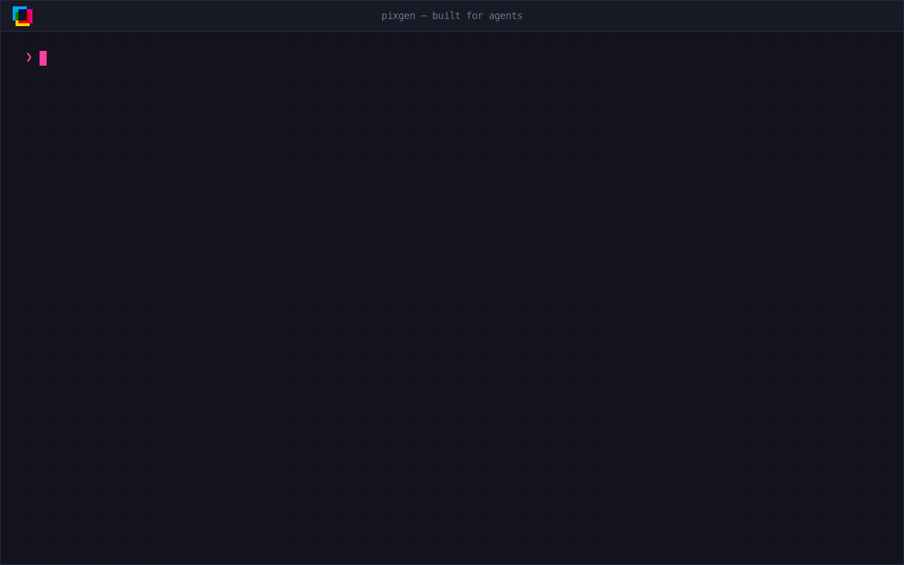
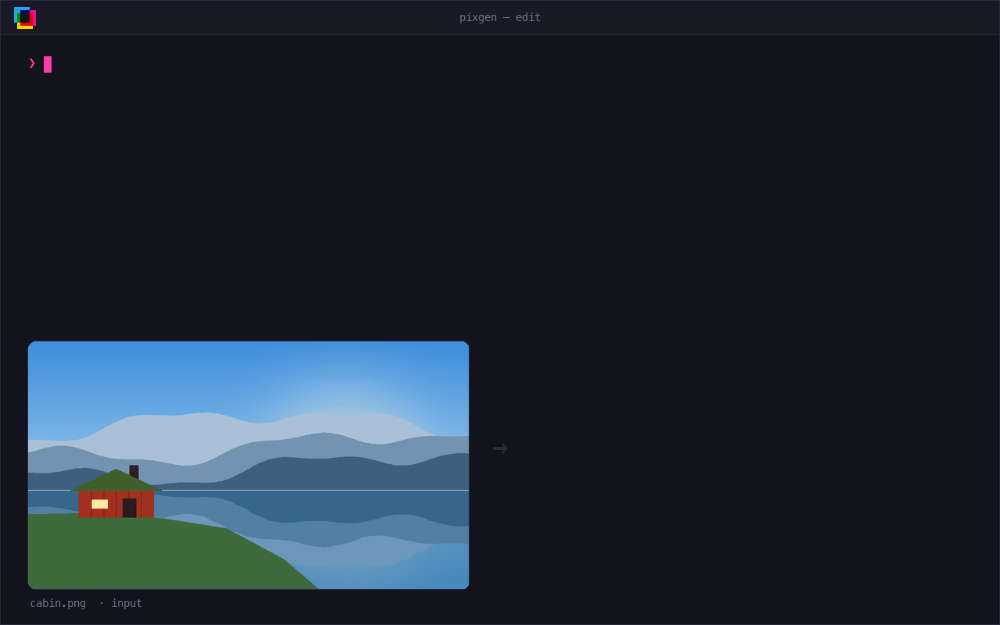
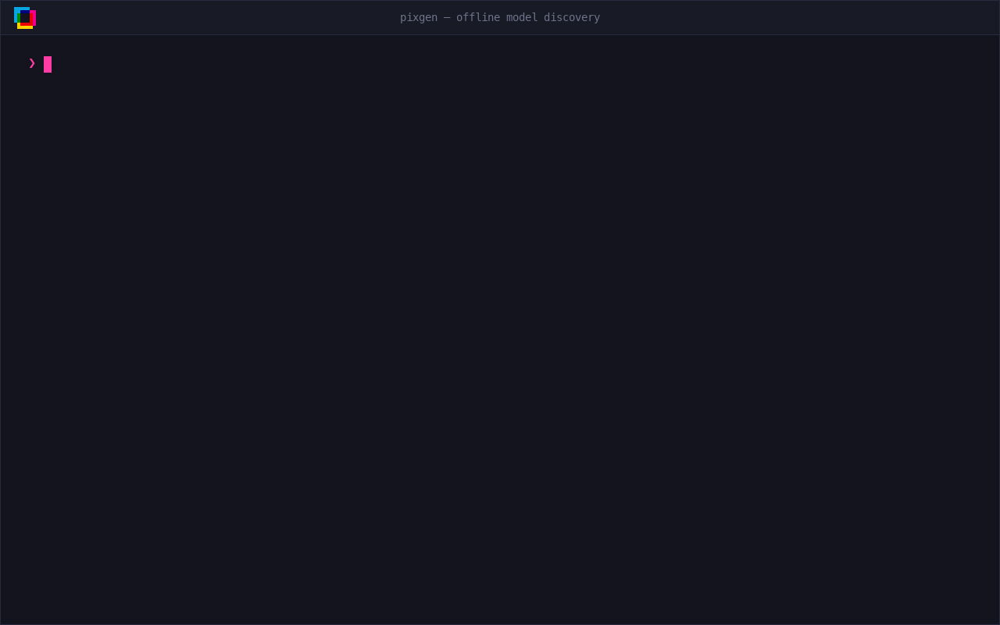

<p align="center">
  <picture>
    <source media="(prefers-color-scheme: dark)" srcset="docs/assets/logo-dark.svg">
    
  </picture>
</p>

<h3 align="center">One CLI. Every image model. Your keys.</h3>

<p align="center">
  Generate and edit images with OpenAI, Google Gemini, and OpenRouter from one typed
  command. Pixgen runs locally, writes plain files, and returns versioned JSON for
  both humans and coding agents.
</p>

<p align="center">
  <a href="https://pypi.org/project/pixgen/"></a>
  <a href="https://pypi.org/project/pixgen/"></a>
  <a href="https://github.com/difegam/pixgen/actions/workflows/ci.yml"></a>
  <a href="LICENSE"></a>
</p>

<p align="center">
  <a href="#quickstart">Quickstart</a> ·
  <a href="docs/demo-commands.md">Tutorial</a> ·
  <a href="#why-pixgen">Why Pixgen</a> ·
  <a href="#agent-skill">Agent skill</a> ·
  <a href="#providers-and-models">Models</a> ·
  <a href="#usage">Usage</a> ·
  <a href="#configuration">Configuration</a> ·
  <a href="#development">Development</a>
</p>

<p align="center">
  
</p>

## Quickstart

Pixgen requires Python 3.14 or newer.

```bash
uv tool install --python python3.14 pixgen   # or try it once: uvx --python python3.14 pixgen --help
```

`uv tool` installs Pixgen into its own isolated environment and puts `pixgen` on
your `PATH`. `--python python3.14` makes uv use (or download) Python 3.14, so it
works even if your default Python is older.

```bash
export OPENAI_API_KEY=sk-...         # bring your own key
pixgen create "A modern cabin beside a Norwegian fjord" \
  --model openai/gpt-image-2 \
  --output cabin.png
```

That's it: `cabin.png` is on disk. Update later with `uv tool upgrade pixgen`.
For a walkthrough that uses Claude Code or Codex to analyse this repository,
then sends the resulting prompts to Pixgen, see the
[image generation tutorial](docs/demo-commands.md). It also covers model groups
and all three providers.

## Why Pixgen

- **One contract, many providers.** The same `create` and `edit` commands work
  across Google, OpenAI, and OpenRouter accounts you authenticate yourself.
- **Fan out in one command.** Repeat `--model`, or name a model group, and Pixgen
  runs every target concurrently, with live per-target progress.
- **Checked before you pay.** Model discovery is offline, and requests are
  validated locally before any paid call reaches a provider.
- **Files you can trust.** Artifacts are written atomically, so you never get a
  half-written image.
- **Built for agents and scripts.** `--json` returns a versioned envelope with
  typed, per-target errors.
- **Bring your own keys.** Not tied to any single provider, account or subscription; pay for what you use with your own API keys.

<p align="center">
  
</p>

## Agent skill

Install the `pixgen-cli` skill to teach Claude Code and Codex agents how to use
Pixgen's CLI, including its JSON output and model groups:

```bash
npx skills add difegam/pixgen --skill pixgen-cli --agent claude-code --agent codex
```

Add `--global` to install it for your user account instead of this project:

```bash
npx skills add difegam/pixgen --skill pixgen-cli --agent claude-code --agent codex --global
```

For image requests, the skill prefers an image-generation tool exposed by the
active agent harness when one is available. Pixgen provides the CLI workflow
when you ask for Pixgen, need its provider and model choices, or want to compare
models. Install Pixgen itself and configure a provider API key to run those CLI
requests; installing the skill only adds agent instructions.

## Providers and models

| Provider | API key | Models | Create | Edit |
| --- | --- | --- | :-: | :-: |
| OpenAI | `OPENAI_API_KEY` | `openai/gpt-image-2`, `openai/gpt-image-1-mini` | ✓ | ✓ |
| Google Gemini | `GEMINI_API_KEY` | `gemini/gemini-3.1-flash-image`, `gemini/gemini-3.1-flash-lite-image`, `gemini/gemini-3-pro-image` | ✓ | ✓ |
| OpenRouter | `OPENROUTER_API_KEY` | `openrouter/google/gemini-3.1-flash-image` (up to 14 reference images) | ✓ | ✓ |
| | | `openrouter/openai/gpt-image-2.5-sunburst` (up to 16 reference images) | ✓ | ✓ |
| | | `openrouter/meta/muse-image` | ✓ | — |

OpenRouter model IDs keep OpenRouter's upstream slug. `muse-image` is create-only
because the Images API does not document reference-image input for it. Reference
images go through OpenRouter's
[Images API](https://openrouter.ai/docs/guides/overview/multimodal/image-generation).

Run `pixgen model list` for the current catalogue. It needs no credentials.

## Usage

### Shared commands

Root `create` and `edit` take canonical `provider/model` IDs and keep each
provider's defaults. `create` accepts repeated `--model` options or one configured
`--group`, but not both. `edit` takes explicit models and the common strict
`width:height` aspect ratio. Ratios are reduced to canonical form (`21:9` becomes
`7:3`), and every selected model must support the value you ask for.

```bash
pixgen create "A modern cabin beside a Norwegian fjord" \
  --group product-hero \
  --output cabin.png

pixgen edit "Remove the background" \
  --image cabin.png \
  --model openai/gpt-image-2 \
  --aspect-ratio 3:2 \
  --output cabin-transparent.png
```

<p align="center">
  
</p>

Combine reference images with a prompt:

```bash
pixgen create "Combine the product and visual style" \
  --group product-hero \
  --reference product.png \
  --reference style.png \
  --output campaign.png
```

<p align="center">
  
</p>

### Local image optimisation

Create common website-ready variants from a local image with Pillow:

```bash
pixgen optimize photo.jpg --web
```

See the [image optimisation guide](docs/image-optimization.md) for custom sizes,
format and quality options, dry runs, and output handling.

### Provider-native commands

Each provider command exposes that provider's native Pydantic parameters as
typed options, and targets one provider-local model. It uses the same preflight,
output, timeout, variant, and JSON rendering as the shared commands.

```bash
pixgen create openai "A modern cabin beside a Norwegian fjord" \
  --model gpt-image-2 \
  --quality high \
  --size 1536x1024 \
  --output cabin.png

pixgen create gemini "A modern cabin beside a Norwegian fjord" \
  --model gemini-3.1-flash-image \
  --aspect-ratio 16:9 \
  --output cabin.png

pixgen create openrouter "A modern cabin beside a Norwegian fjord" \
  --model google/gemini-3.1-flash-image \
  --resolution 2K \
  --aspect-ratio 16:9 \
  --output cabin.png

pixgen edit openrouter "Remove the background" \
  --image cabin.png \
  --model openai/gpt-image-2.5-sunburst \
  --quality high \
  --output cabin-transparent.png
```

OpenRouter commands accept either the upstream slug or the full Pixgen ID after
`--model`. Groups only apply to root `create`. Provider-native commands keep
their own options.

> [!TIP]
> If your whole prompt matches a provider command name, pass it explicitly:
> `pixgen create --prompt "openai"`.

### Model groups

Save a line-up of models once, then reuse it with `--group`:

```bash
pixgen group create product-hero \
  --model openai/gpt-image-2 \
  --model gemini/gemini-3.1-flash-image \
  --description "Models suited to product hero images" \
  --tag product \
  --tag marketing

pixgen group list        # or: pixgen group ls
```

In an interactive terminal, leave out `--model` to fuzzy-search and multi-select
models, then enter a description and optional tags. Group names must be new, and
`group create` never replaces an existing group. Models are validated locally and
the group is written to the resolved TOML configuration. No provider credentials
are used.

### Model discovery

`pixgen model list` and `pixgen model get <provider/model>` work offline.
`model list` shows an interactive table by default, a grouped view with `--tree`,
or machine-readable output with `--json`. `model get` reports native parameter
schemas and supported shared aspect ratios.

<p align="center">
  
</p>

<details>
<summary><strong>Shell completion</strong></summary>

Enable completion for bash, zsh, or fish:

```bash
pixgen --install-completion
```

Restart the shell, or source its RC file, for completion to take effect. See the
[cyclopts shell completion docs](https://cyclopts.readthedocs.io/en/latest/shell_completion.html)
for manual installation and troubleshooting.

</details>

## Configuration

Set API keys in the environment. Prefixed and unprefixed names both work:

```bash
OPENAI_API_KEY=sk-...        # or PIXGEN_OPENAI_API_KEY=sk-...
GEMINI_API_KEY=...           # or PIXGEN_GEMINI_API_KEY=...
OPENROUTER_API_KEY=...       # or PIXGEN_OPENROUTER_API_KEY=...
```

> [!IMPORTANT]
> Credentials come only from environment variables or an optional `.env` file in
> the Pixgen user config directory (next to `config.toml`). A `.env` in the
> current directory is never read, and credentials are never read from TOML files.

Optional settings use the `PIXGEN_` prefix and nest with `__`:

```bash
PIXGEN_CONFIG=/absolute/path/to/pixgen.toml
PIXGEN_GENERATION__MAX_PARALLEL_REQUESTS=4
PIXGEN_GENERATION__MAX_VARIANTS=10
PIXGEN_GENERATION__MAX_JOBS=10
PIXGEN_GENERATION__REQUEST_TIMEOUT_SECONDS=300
PIXGEN_GENERATION__REQUEST_RETRIES=0
PIXGEN_GENERATION__OUTPUT_DIR=./output
```

`generation.request_retries` sets the number of automatic retries per provider
request and defaults to `0`. Retrying timed-out image generation requests can
produce duplicate images if a provider completed the request but its response
was lost. Retry behaviour depends on the provider's transport; for example,
OpenAI and OpenRouter retry connection errors, while Gemini also retries
transient API errors and timeouts.

Reusable create-only model groups live in the TOML configuration:

```toml
[groups.product-hero]
description = "Models suited to product hero images"
tags = ["product", "marketing"]
models = [
  "openai/gpt-image-2",
  "gemini/gemini-3.1-flash-image",
]
```

`description` and `tags` are presentation metadata shown by `group list`. They
do not affect generation.

## Roadmap

Not in Pixgen yet: video generation, OS-keyring credentials, UUIDv7 history,
resumable background video, external provider plugins, MCP, workflow
orchestration, local inference, and `group show`.

> [!NOTE]
> **Upgrading from an earlier version?** The old `pixgen image ...` group and the
> generic `--param` option were removed. Provider-specific options now belong to
> the provider command.

## Development

The project uses [uv](https://docs.astral.sh/uv/),
[just](https://github.com/casey/just), Ruff, Pyrefly, pytest, and pre-commit:

```bash
just init        # uv sync + install hooks
just lint        # ruff check --fix + ruff format
just type-check  # pyrefly
just test        # pytest
just check       # full hook suite
```

The terminal animations in this README are rendered by
[`docs/demo/render_demos.py`](docs/demo/render_demos.py). It needs no API keys
and requires `ffmpeg`:

```bash
uv run python docs/demo/render_demos.py           # all demos
uv run python docs/demo/render_demos.py create    # just one
```

<details>
<summary><strong>Releasing</strong></summary>

Releases are published to PyPI by the Release workflow when a version tag is
pushed. Publishing uses PyPI trusted publishing (OIDC), so no token is stored,
and uploads include PEP 740 attestations.

```bash
just build              # build sdist and wheel into dist/
just release minor      # bump (patch|minor|major), commit, and tag vX.Y.Z
git push origin main vX.Y.Z
```

The workflow runs the CI checks, builds with `uv build --no-sources`, smoke
tests the wheel and source distribution, then publishes from the `pypi`
environment once it is approved. The tag must match the version in
`pyproject.toml`, or the workflow fails before building. See
[Releasing](docs/releasing.md) for the one-time PyPI setup and troubleshooting.

</details>

### Documentation

- [Product and implementation plan](.knowledge/pixgen.md)
- [Project scope](.knowledge/PROJECT.md)
- [Architecture](.knowledge/ARCHITECTURE.md)
- [Future ideas](.knowledge/IDEA.md)
- [Releasing](docs/releasing.md)

## License

MIT. See [LICENSE](LICENSE).
