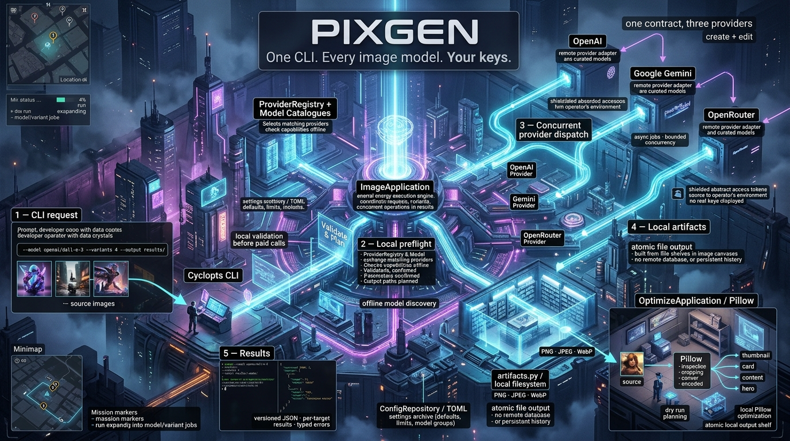
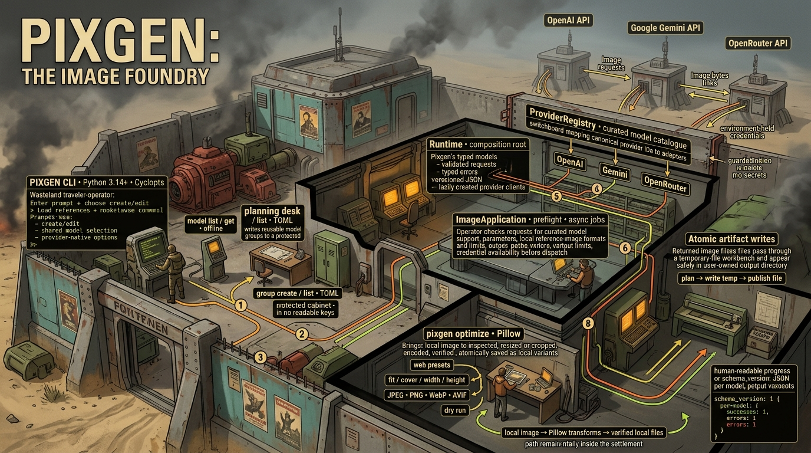

# Generate repository architecture images with Pixgen

This walkthrough uses the two architecture prompt Gists to ask Codex or Claude
Code to inspect the Pixgen repository. Pixgen then sends each finished prompt to
Gemini to generate a cyberpunk or post-apocalyptic architecture image. The
examples use temporary files so the generated prompts and images stay together.

The images below were generated by Pixgen with Gemini 3.1 Flash Image from the
Codex-produced prompts. They are 16:9 JPEGs at 1376 × 768. Image models may
render some small technical labels inaccurately.





The source instructions are [the cyberpunk architecture Gist](https://gist.github.com/difegam/ed10ef43be04738b8ff002e53d974182#file-repo-cyberpunk-architecture-prompt-md)
and [the Fallout architecture Gist](https://gist.github.com/difegam/ed10ef43be04738b8ff002e53d974182#file-repo-fallout-architecture-prompt-md).

## 1. Install Pixgen and choose an image provider

Pixgen requires Python 3.14 or newer. Install it with `uv`:

```bash
uv tool install --python python3.14 pixgen
```

The main workflow below uses Gemini. Create a [Gemini API key in Google AI
Studio](https://aistudio.google.com/app/api-keys), then enter it without adding
the key text to shell history:

```bash
printf "Gemini API key (input hidden): "
IFS= read -r -s GEMINI_API_KEY
printf '\n'
export GEMINI_API_KEY
```

Keep the key out of `pixgen.toml`, source files, and command arguments. The
Claude Code or Codex CLI steps use those tools' own sign-in and may use their
own accounts or billing.

## 2. Fetch both Gist instructions

Run the following commands from the Pixgen repository root. `set -euo
pipefail` makes the shell stop if a Gist download fails, instead of continuing
with an empty prompt argument.

```bash
set -euo pipefail

DEMO_DIR="$(mktemp -d "${TMPDIR:-/tmp}/pixgen-architecture.XXXXXX")"
CYBERPUNK_GIST_URL="https://gist.githubusercontent.com/difegam/ed10ef43be04738b8ff002e53d974182/raw/b5e7927001a9c26f3e422e7d7f0ddacdc5c89d6a/repo-cyberpunk-architecture-prompt.md"
FALLOUT_GIST_URL="https://gist.githubusercontent.com/difegam/ed10ef43be04738b8ff002e53d974182/raw/b5e7927001a9c26f3e422e7d7f0ddacdc5c89d6a/repo-fallout-architecture-prompt.md"

curl -fsSL "$CYBERPUNK_GIST_URL" -o "$DEMO_DIR/repo-cyberpunk-prompt.md"
curl -fsSL "$FALLOUT_GIST_URL" -o "$DEMO_DIR/repo-fallout-prompt.md"
test -s "$DEMO_DIR/repo-cyberpunk-prompt.md"
test -s "$DEMO_DIR/repo-fallout-prompt.md"
printf 'Demo files: %s\n' "$DEMO_DIR"
```

Each URL is assigned before it is used. Keep this terminal open so `DEMO_DIR`
and the fetched prompts remain available to the following commands.

## 3. Ask Codex to analyse the repository

`codex exec` reads the prompt from each Gist and writes only the final image
prompt to the named output file. Run it from the Pixgen repository root so
Codex analyses this checkout. The read-only sandbox permits repository
inspection without source changes.

```bash
codex exec \
  -s read-only \
  -m gpt-6-luna \
  -c model_reasoning_effort=high \
  -o "$DEMO_DIR/architecture-prompt-cyberpunk.txt" \
  "$(cat "$DEMO_DIR/repo-cyberpunk-prompt.md")"

test -s "$DEMO_DIR/architecture-prompt-cyberpunk.txt"

codex exec \
  -s read-only \
  -m gpt-6-luna \
  -c model_reasoning_effort=high \
  -o "$DEMO_DIR/architecture-prompt-fallout.txt" \
  "$(cat "$DEMO_DIR/repo-fallout-prompt.md")"

test -s "$DEMO_DIR/architecture-prompt-fallout.txt"
```

If you prefer Claude Code, use its plan mode to analyse the cyberpunk Gist
instead. This writes the generated image prompt to a separate file:

```bash
claude -p \
  --model haiku \
  --permission-mode plan \
  < "$DEMO_DIR/repo-cyberpunk-prompt.md" \
  > "$DEMO_DIR/architecture-prompt-claude.txt"

test -s "$DEMO_DIR/architecture-prompt-claude.txt"
```

## 4. Generate both images with Pixgen

Send the repository-specific prompts to Gemini. Pixgen writes the returned
images under the temporary directory:

```bash
pixgen create gemini "$(cat "$DEMO_DIR/architecture-prompt-cyberpunk.txt")" \
  --model gemini-3.1-flash-image \
  --aspect-ratio 16:9 \
  --output "$DEMO_DIR/cyberpunk.jpg"

pixgen create gemini "$(cat "$DEMO_DIR/architecture-prompt-fallout.txt")" \
  --model gemini-3.1-flash-image \
  --aspect-ratio 16:9 \
  --output "$DEMO_DIR/fallout.jpg"
```

To use the Claude-produced cyberpunk prompt, replace the first prompt filename
with `architecture-prompt-claude.txt`. These are paid image-generation requests.
Pixgen chooses the output encoding returned by the provider, so use `.jpg` for
Gemini's JPEG output.

## 5. Compare models with a saved group

A model group can send one prompt to OpenAI, Gemini, and OpenRouter in one
command. This optional comparison requires keys for all three providers. Add
keys to the current shell as described in the providers' key documentation,
then create a group:

```bash
pixgen group create architecture-demo \
  --model openai/gpt-image-2 \
  --model gemini/gemini-3.1-flash-image \
  --model openrouter/openai/gpt-image-2.5-sunburst \
  --description "Repository architecture prompt comparison" \
  --tag architecture \
  --tag demo

pixgen group list

pixgen create "$(cat "$DEMO_DIR/architecture-prompt-fallout.txt")" \
  --group architecture-demo \
  --output-dir "$DEMO_DIR/fallout-comparison" \
  --mkdir
```

Group creation validates model IDs locally and saves the group in Pixgen's TOML
configuration. It does not make provider requests. Group names must be new; if
`architecture-demo` already exists, choose another name for both commands.

## 6. Try provider-native options

Provider-native commands expose provider-specific parameters. Run these
individually to compare settings or output formats:

```bash
pixgen create openai "$(cat "$DEMO_DIR/architecture-prompt-cyberpunk.txt")" \
  --model gpt-image-2 \
  --quality high \
  --size 1536x1024 \
  --output "$DEMO_DIR/openai.png"

pixgen create gemini "$(cat "$DEMO_DIR/architecture-prompt-cyberpunk.txt")" \
  --model gemini-3.1-flash-image \
  --aspect-ratio 16:9 \
  --output "$DEMO_DIR/gemini.jpg"

pixgen create openrouter "$(cat "$DEMO_DIR/architecture-prompt-cyberpunk.txt")" \
  --model google/gemini-3.1-flash-image \
  --resolution 2K \
  --aspect-ratio 16:9 \
  --output-dir "$DEMO_DIR/openrouter" \
  --mkdir
```

The provider-native commands use provider-local model names. The shared root
command and model groups use canonical `provider/model` IDs. For current model
availability and command options, see `pixgen model list`,
`pixgen model get <provider/model>`, and the
[Pixgen command reference](../skills/pixgen-cli/references/commands.md).
